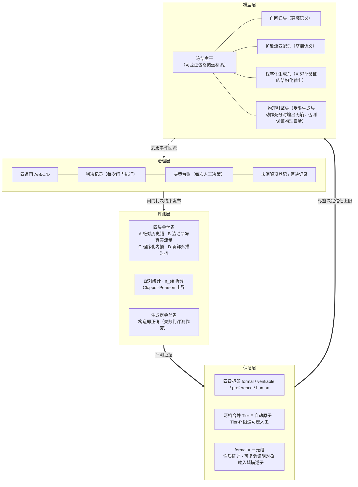
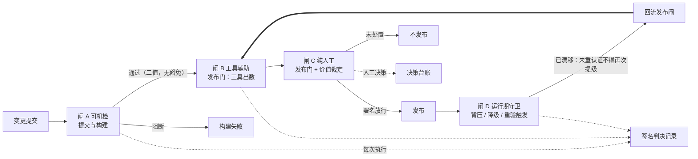

# DSOM v5.0 自演化系统 · 架构总览

> **来源与性质**：本文由《DSOM v5.0 自演化系统终极治理方案（最终封卷版 · 第十二卷，2026-10-21）》整理而成，是把该方案中的结构性内容抽成架构图与规约表的**派生资料**。
> - 本文**不是**《拾光剪影》的现行开发依据，与 `docs/现行技术文档.md` 无关，也不进入其活路径。
> - 原文纯文本留档：[docs/_tmp/DSOM_v5.0_text.md](../_tmp/DSOM_v5.0_text.md)（提取自 docx，仅供本仓库参考）。
> - 整理原则：不改写、不新造概念；原文的口径修正（第七章）一律按修正后的表述采用。
> - 编号记法：原文以 ′/″/‴/⁗ 表示法条版本层级（v3.0′ 层 / v3.0″ 层 / v4.x 层 / v5.0 层）。本文统一记作 `I114-w`（= I114⁗）、`I100-3`（= I100‴），层级语义见 §10。

---

## 1. 一句话定位

> **每一次变化都必须能被指认「由什么强度担保、在什么输入范围内成立、由谁署名放行」，三者缺一即不得发布。**

- 它**不是**让模型变聪明的方法，而是一套让持续变化的系统在缺少全知监督的前提下**仍可被审计**的治理体制。
- 不承诺模型变强；只保证：变强的部分可核对、变坏的部分可归因、归因之后可处置。
- 状态声明：**架构闭合，问题不闭合**（原文拒绝签署「终局 / 封卷」；未消解项由 9 项增至 11 项，其中 2 项无消解路径，见 §12）。

## 2. 架构大图（四层）



| 层 | 核心构件 | 关键不变量 |
|---|---|---|
| 模型层 | 冻结主干 + 三个并列采样头（自回归/扩散、程序化、物理引擎） | 主干冻结理由：**坐标系**（换版即全量再认证风暴），**不是**防灾难性遗忘；物理引擎头须配求解器系综，引擎版本与标签版本强绑定 |
| 保证层 | 四级标签 + 两档合并 | 系统对某变更的信任**不得超过其标签等级**；等级**不可**由证据积累或日历爬升 |
| 评测层 | 四集金丝雀 + 配对统计 | 金丝雀失败 ⇒ **评测作废**，不判模型退化；抽样不产生漏放，产生「永远无法认证」 |
| 治理层 | 四道闸 + 判决记录 + 决策台账 | **没有判决记录的通过 = 根本没跑**；闸门与判定工具自身是高权限制品，变更权限高于生产代码 |

## 3. 受约束制品（四类）

| # | 制品类 | 内容 | 特殊纪律 |
|---|---|---|---|
| 1 | 主干与采样头 | 模型层全部构件 | 主干冻结 = 坐标系冻结 |
| 2 | 判定器与规则库 | 保证/评测的规则侧 | 学习型判定器无可归因规则 ⇒ 不可差分域（§9） |
| 3 | 评测集与生成器 | A/B/C/D 四集 + 金丝雀生成器 | 「构造即正确」前提在生成器侧 |
| 4 | **闸门与判定工具本身** | 治理层代码 | 最易被漏；**改闸门永远比改被审对象便宜** ⇒ 变更须过 C5 类自检并留判决记录 |

## 4. 系统时钟（容量总模型）

```
进化速率 = min(生成带宽, 验证带宽, 裁定带宽)
```

- 取最小不是修辞：能推进的版本数由最窄一条决定，现实中**永远是裁定带宽**。
- **加卡只动前两条**（生成/验证），对裁定带宽无益。
- 全文两大定量工作（§7、§8、§9）都是在给这条公式的裁定带宽项做**可计算定标**，并堵住「用虚假指标假装满足带宽」的通道。

## 5. 发布流水线（四道闸数据流）



| 闸门 | 执行时机 | 判决形式 | 人的权限 | 失败后果 |
|---|---|---|---|---|
| A 可机检 | 提交与构建 | 通过/阻断（二值） | **无，不得豁免** | 构建失败 |
| B 工具辅助 | 发布门 | 工具出数，人作封闭处置 | 仅处置，不判定 | 未处置即不发布 |
| C 纯人工 | 发布门与价值裁定 | 人工署名结论 | 判定与处置均在人 | 计入裁定带宽 |
| D 运行期守卫 | 生产运行 | 背压/降级/重验触发 | 归因排查后签字 | 模块降级并**回流发布闸** |

三条原则（判定纪律，作用于所有闸）：

1. **可验证性不对称**：裁判强弱取决于「验证是否比伪造便宜」，由问题类型决定，不由预算决定。给学习型判定器堆算力，只是把可钻空隙搬到更高维。
2. **机器判「是否」，人判「怎么办」**：检测必须机器、预注册、可复算；人只有处置权（退役/缩包络/接受风险并署名/降级），**无判定权**。人的判断一旦进入判定环节，即成单向放宽通道。
3. **自指合法，自证禁止**：判据 = 判决所依据的证据是否由被该判决约束的一方生成或可销毁、能否被独立第三方复算。模块读自己成绩调路由 = 合法；被测模型仲裁团删掉证明其退化的样本 = 自证（禁止）。

## 6. 标签与合并模型

- **四级标签**：`formal` ＞ `verifiable` ＞ `preference` ＞ `human`；每次权重变更携带标签，系统信任不得超过其等级。
- **formal 非布尔，是三元组**：①机器可检的性质陈述 ②可机械复验的证明对象 ③成立的输入域描述子。
- **两档合并**：
  - Tier-F：凭解析恒等证明，**自动、原子发布**。
  - Tier-P：凭分布不退化 + 按构造多样的偏好投票 + 人工署名，**限速、可逆、不可自动**。
- 禁止项：等级由证据积累爬升（I110⁗）；formal 降级 + 日历保鲜期（第 10 项否决：形式证明不落在特征坐标上）。
- 形式证明不覆盖非形式语义域：该域合并天生是概率性的（七条不承诺之六）。

## 7. 裁定带宽容量模型（M_max，本轮核心成果）

红方原式 `M_max = 人工裁定带宽（条/天）× 可容忍卡点天数` 方向正确（从系统时钟最窄漏斗反推，而非拍常数），但按字面执行会在三处失效：

| 原口径 | 病因 | 修正 | 法条 |
|---|---|---|---|
| 用**总**裁定带宽 | 裁定带宽是共享资源，常设义务（争议终审、金丝雀重裁定、D 闸回流）优先占用 | 按**剩余**带宽定标；常设义务清单随版本记录公开 | I114⁗ |
| 以「**条**」计费 | 翻转样本单位裁定成本跨域相差数倍，「条」是虚构等价单位 | 以**决策分钟**为唯一计费单位；各域单位成本由台账实测、季度重标 | I115⁗ |
| 随排班**自动调低** | M_max 时变 ⇒ 同一变更不同时刻判决不同，判决不可复算 | 按发布周期**预注册并随版本记录冻结**（并入标定 C8） | I116⁗ |
| 卡点天数由发版方自填 | 与被否的「三根旋钮」同源：被审对象调节自己被审查的强度 | 定性为**风险接受项**，走 I87‴ 封闭处置集：署名≠变更作者、给范围与新到期日、不得无限续期 | I117⁗ |

**四项规范量（全部进入版本记录）**：

| 量 | 定义 | 来源 | 更新节拍 |
|---|---|---|---|
| 总裁定带宽 | 单位周期可用决策分钟数（不含加班） | 决策台账实测 | 季度 |
| 常设义务占用 | 争议终审＋金丝雀重裁定＋D 闸回流的分钟配额 | 闸门 B/D 排程记录 | 季度 |
| 剩余裁定带宽 | 总带宽 − 常设义务 | 计算量 | 季度 |
| 卡点期 | 以风险接受形式署名的可容忍停滞周期 | I87‴ 处置记录 | 到期重签 |

**基准实测数据**（原文 4.2）：总带宽 3000 决策分钟/天；常设义务 1550（800/450/300）；剩余 1450，仅为总带宽 48.3%。同一 2900 分钟预算：代码域 1450 条（2 分钟/条）、结构化抽取 580 条（5）、长文生成 242 条（12）——「条/天」把 6 倍成本差异抹平，故不得作门禁输入。若按红方口径放行 1000 条长文变更，占用期间常设义务 3100 分钟到期未处置 ⇒ 按 I87‴ 自动升级三项**与本变更无关**的模块发布阻断。

## 8. 规则库完备度模型（U-11 盲区率否决后的替代架构）

**被否公式**：`盲区率 =（D 集漏洞数 + 事故数）÷（例外总数 + D 集漏洞数 + 事故数）`
致命性质：**构成比不是覆盖率**，分子各项都在分母中 ⇒ 指标对审计侧投入**单调下降**——裁掉红队，比率从 0.3939 改善至 0.1304 并稳定通过门禁。任何系统以它作门禁，其最优策略是取消自己的安全测试。

**替代架构（I118⁗）**：

1. **可计算形式**：构造**已知答案探针库**（植入时即知缺陷类型与预期规则归属）；不完备度只报 `1 − 捕获率` 的**单侧置信下界**。
2. **可观测上限**：不完备度**只有下界**；下界的强度不是统计量而是**谱系声明**——「探针库作者与规则库作者不同源」的信息量大于任何置信区间。同源谱系实测：捕获率 1.0000、下界报 0.9991，真实不可见不完备 0.2100，**相差 233 倍**（Rice 在治理层的最后一次复现，无算力解，未消解项 U-10）。
3. **遥测降级**：D 集投送量、例外计数、事故计数一律降为遥测量，**禁止进入发布门禁**。
4. **事故计数单独处置**：事故受报告漏斗选择偏差污染 ⇒ 强制进规则重构队列（红方该条正确，已签署）；计数进门禁必须先除以暴露量，报告率独立单列；报告率异常下降时事故计数不得作为改善证据。
5. **固化标定项 C11**：任何不完备度声明必须附探针库作者谱系声明，缺一即判该声明无效。

## 9. 不可差分判定器域（M_max 的定义域边界，I119⁗）

- 前提失效：I112⁗ 把判定器变更拆到规则粒度定 M_max，隐含「变更可拆分」；学习型判定器**无规则可归因**（实测：几何分簇纯度 0.5866 vs 基线 0.5036，规则归因纯度 0.5046 ≈ 随机——双双退化），换版是**不可分割原子事件**，人工账单恒等于翻转集规模 ⇒ M_max 在该域**无定义**（不是太大，是不可计算）。
- **禁止**把 M_max 作通用门禁施加：现场必然演化为「把不可拆的变更伪装成可拆」（按批次切分翻转集逐批签字）。
- 替代处置：不可差分判定器换版 ⇒ **整域退回 Tier-P 限速 + 对该组合限期冻结**；重认证 = 穷举复跑 + 翻转集全量人工终审，**禁止抽样探针替代**。
- 选型纪律：必须以系统时钟单位标价这笔账单——**选学习型判定器，就是接受该域进化速率由裁定带宽单独决定**。

## 10. 法条体系与编号层级

- 累计 119 条：I1–I40（40）、I41′–I61‴（21）、I62‴–I79‴（18）、I80‴–I100‴（21）、I101⁗–I113⁗（13）、I114⁗–I119⁗（6）。纪律型 96 / 预算型 23（归属系前几卷逐项累加，非新判断；重归类须以 I87‴ 署名）。**编号总数 119 是累计结果，不得当叙事使用。**
- 符号层级（不得混排，第七章修正项）：`′`= v3.0′ 层 · `″`= v3.0″ 层 · `‴`= v4.x 层 · `⁗`= v5.0 层。
- 本轮新增 6 条：I114⁗–I119⁗（内容见 §7、§8、§9 对应表）。
- 历史编号漂移修正：**I100‴**（处置必须可负担），原文误作 I100⁗。

## 11. 否决记录（架构的负空间，累计 13 项）

> 否决记录是本规范最有价值的部分：把踩过的坑变成后来者的免费护栏。

| # | 被否提案 | 否决要点 | 替代条款 |
|---|---|---|---|
| 1 | I51′ 裁判算力霸权 | 与 I43‴ 冲突，推向学习型裁判 | I51″ 可验证性不对称 |
| 2 | I52′ 熵下限 + 十万偏好模型 | 只锁散度不锁朝向；同源集成 = 一致的马屁精 | I52″、I54″ |
| 3 | I53′ 物理引擎作最终采样器 | 无视动作充分性；引擎自身是新的冻结裁判 | I53″ 受限生成头 |
| 4 | I56″ 满 N 次触发重验 | 执行次数是暴露量代理，最危险的模块最晚触发 | I56‴ 协变量偏移触发 |
| 5 | I57″ 以分支覆盖率定义 formal | 覆盖率是教科书级可刷代理 | 变异杀死率 + 性质测试深度 |
| 6 | I64‴ 模型仲裁团删样 | 单向棘轮：被试有权销毁退化证据 | I69‴ 立案不删样、争议率阻断 |
| 7 | I65‴ 800 条置信下限 | 统计量选错，名义样本未折算 | I67‴ n_eff、I68‴ 配对统计 |
| 8 | 迁移协议一（普氏对齐 + KL） | 变换欠定、判决不可排序、密度冒充证书（0/4） | 判决级穷举复跑 |
| 9 | 迁移协议二（路由权重阈值划闭包） | 激活概率是暴露量非重要性；漏检 63% | 按判决翻转集定义闭包 |
| 10 | 迁移协议三（formal 降级 + 日历保鲜期） | 形式证明不落在特征坐标；等级不随日历爬升 | I98‴、I99‴ |
| 11 | I104‴ 全归罪总线 / I105‴ 永久冻结 | 不产生安全只产生错误归因；不可负担的惩罚只会被绕过 | I105⁗ 限期冻结、unattributable |
| 12 | I107⁗/I108⁗/I110⁗ REO 聚类降载 | 几何聚类纯度 = 随机基线；簇内方差循环论证；日历不产生证据 | I107⁗ 因果归因、I108⁗ 禁簇内自证、I110⁗ 等级不随日历 |
| 13 | **本轮**：U-11 盲区率构成比公式；M_max 以总带宽与「条」定标 | 门禁强度随审计投入反向变化；带宽口径失真 2.00×、单位口径失真 6.0× | I114⁗–I118⁗ |

## 12. 未消解项登记（11 项，I87‴ 生效形式）

每项登记责任人、复核节拍与到期处置；责任人在封卷版中为占位，落地时须以署名替换；**逾期未处置自动升级为对应模块发布阻断**。

| 编号 | 事项 | 类别 | 节拍 | 到期处置 |
|---|---|---|---|---|
| U-1 | ρ 在真实流量近重复簇上无先验，只能试点估计 | 待标定 | 季度 | 消解或接受风险 |
| U-2 | A 集缺失效准则（绝对锚与时代脱节的折中点未定） | 设计缺口 | 半年 | 接受风险并署名 |
| U-3 | 人工终审吞吐上限 = 裁定带宽绝对天花板 | 外部约束 | 季度 | 接受风险并署名 |
| U-4 | 流式输入下支持度统计量的时序聚合窗口无原则性选法 | 设计缺口 | 季度 | 接受风险并署名 |
| U-5 | 闸门 D 的背压参数无先验 | 待标定 | 季度 | 消解或接受风险 |
| U-6 | 闸门 C 的「谱系不同源」目前只能靠指纹近似 | 证明缺口 | 半年 | 接受风险并署名 |
| U-7 | 决策成本埋点需 M1 运行数据，当前无实测分布 | 待数据 | 季度 | 消解 |
| U-8 | 证书半径对有效样本量的依赖（半径随 n_eff 收缩） | 接受并署名 | 季度 | 已接受 |
| U-9 | 总线换版再认证风暴的工期不可由算力压缩 | 接受并署名 | 半年 | 已接受 |
| **U-10** | 探针库谱系与被审方同源时不完备度不可定级（本轮新增） | 接受并署名 | 半年 | 已接受：**无消解路径，Rice 复现** |
| **U-12** | 学习型判定器域的 M_max 无定义（本轮新增） | 接受并署名 | 半年 | 已接受：替代处置见 I119⁗ |

## 13. 七条不承诺（置于架构前部，不得移入附录）

1. 不承诺安全，只承诺带适用范围的许可；**许可越界使用 = 无许可**。
2. 不承诺可验证包络闭合（语义全域判定不可判定，Rice；「分布对人好」不可被族内判定器穷尽）。
3. 不承诺无人值守。
4. 不承诺「未观察到退化即没有退化」——低功效检验**保留否决权、丧失认证权**。
5. 不承诺进化速率；速率由最窄带宽决定，不可用算力直接抬升。
6. 不承诺形式证明覆盖非形式语义域（该域合并天生概率性）。
7. 不承诺规则库完备；其不完备度只有下界（§8）。

## 14. 架构决策速查（给实现者）

| 若要… | 必须… | 禁止… |
|---|---|---|
| 定标发布吞吐 M_max | 剩余带宽 × 预注册卡点期，决策分钟计费，随版本冻结 | 用总带宽、用「条」、随排班时变、发版方自填卡点天数 |
| 度量规则库不完备度 | 已知答案探针库捕获率单侧下界 + 谱系声明（C11） | 用盲区率/例外数/事故数/D 集投送量作门禁 |
| 换学习型判定器版本 | 整域退 Tier-P 限速 + 限期冻结 + 穷举复跑 + 翻转集全量人工终审 | 按批次切分翻转集伪装可拆、抽样替代 |
| 动主干 | 触发全量再认证，按坐标系换版对待 | 以「防灾难性遗忘」为由解冻、或称 LoRA 即不遗忘 |
| 做回滚 | 图式回滚（沿依赖闭包，闭包内不可回滚者同时降级）；决策级复检优先 | 裸版本回退并声称状态保持 |
| 声明质量属性 | 四可：可验证（带适用范围）、可归因（穷举优先于抽样）、可回滚（图式）、可归责（署名 + 不可篡改记录） | 只说「可验证可归因可回滚」漏掉可归责 |
| 修改闸门/判定工具 | 按高权限制品管理，过 C5 类自检并留判决记录 | 与改生产代码同权限 |
| 声称消解了某未消解项 | 出示消解证据 | 沉默处理（按 I87‴ 视同逾期） |

## 15. 与原文追溯矩阵

| 本文节 | 原文出处 |
|---|---|
| §1 定位 / §13 不承诺 | 第一章 |
| §2 四层 / §5 四道闸表 / §6 标签 | 第二章（表1） |
| §5 三原则 / §4 系统时钟 | 第三章 |
| §7 M_max | 第四章（表2–4）、第八章 I114⁗–I117⁗、第十二章失败一 |
| §8 完备度 | 第五章（表5–6）、第八章 I118⁗、第十二章失败二 |
| §9 不可差分域 | 第六章、第八章 I119⁗ |
| §2/§14 口径修正 | 第七章（表7） |
| §10 法条 / §11 否决 / §12 未消解 | 第九、十、十一章（表8–11） |
| §1 架构闭合声明 / §12 无消解路径 | 签署声明、第十三章 |

## 16. 术语表

| 术语 | 释义 |
|---|---|
| 翻转集 | 判定器换版前后判决发生翻转的样本集合；裁定账单的计量对象 |
| n_eff | 有效样本量 `n / (1 + (m−1)ρ)`；名义样本须按相关结构折算后才可作置信承诺 |
| 金丝雀 | 「构造即正确」的生成器自检件；其失败判**评测作废**而非模型退化 |
| Tier-F / Tier-P | 两档合并通道：解析恒等证明自动原子 / 偏好投票 + 人工署名限速可逆 |
| 判决记录 | 每次闸门执行落一条签名记录；无记录的通过 = 根本没跑 |
| 决策台账 | 每次人工决策的记录体；总裁定带宽与单位成本的实测数据来源 |
| 可验证包络 | 由形式证明与机械复验围成的可审计区域；其坐标系 = 冻结主干 |
| SDT / 证书半径 | 支持域表述；半径随 n_eff 收缩（U-8） |
| I87‴ 封闭处置集 | 风险接受类处置的固定选项集：署名身份不得与变更作者同一、须给范围与新到期日、不得无限续期 |
| Rice（定理） | 非平凡语义性质全域不可判定；本文两处「无算力解」的根据 |

---

*整理：本仓库派生资料。唯一事实仍是原 docx 封卷文本；如与原文冲突，以原文及 [docs/_tmp/DSOM_v5.0_text.md](../_tmp/DSOM_v5.0_text.md) 为准。*
