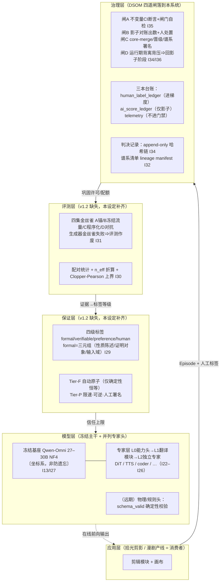

# 自演化模型系统 · 架构设定 v2.0（统一版）

> **性质**：本设定是《DSOM v5.0 治理方案（封卷版）》×《推理时权重自优化系统 v1.2》两份文档的**融合修订稿**，把治理章程落到模型架构设定上；应用侧引用《AI 漫剧自研剪辑与 AI 画布生成系统》仅作下游消费者接口。
> **编号规则**：继承 v1.2 不变量 I1–I26（编号不变，含义以本文为准，被修订处标注〔改〕）；本设定新增 **I27–I36**（v2.0 层，记 ′ 为 `I27+` 段）。DSOM 法条以 `I1xx⁗` 引用。
> **对账依据**：三份原文纯文本见同目录 `docs/_tmp/`；修订点与原文出处的映射见 §11。
> **诚实声明**：本设定不承诺模型变强（继承 DSOM 七条不承诺，不得移入附录）；它只承诺——每一次权重变化能被指认「由什么强度担保、在什么输入域成立、由谁署名放行」。

---

## 0. 一页总览：系统是什么、不是什么

| 问题 | 答案 |
|---|---|
| 这是什么 | 一个**单机可自演化**的多模态决策模型系统：冻结 4-bit 基座 + 能力专家（LoRA/DiT/TTS）+ 睡眠巩固 + 人工标签驱动，变化全程可审计 |
| 这不是什么 | 不是拾光剪影的模块。拾光剪影是它的**采集前端与标签来源**（P-mini 形态，§8），训练形态（P-full）需要另一台 24GB+ 的机器 |
| 瓶颈在哪 | **裁定带宽**：人工标签覆盖率与人工处置带宽。加卡只动生成/验证带宽（DSOM 系统时钟），本设定的全部节流围绕它设计（I33） |
| 演化上限 | 专家规模 L0→L1→L2，受显存预算硬顶（I26）；core-merge 默认关闭且永久低频（I27） |

## 1. 统一架构大图（五层）



**数据流不变**（继承 v1.2 一句话架构）：在线＝纯前向+打分+落记忆+路由（无梯度，I1/I2）；睡眠＝离线分块全精度反向+重放（绕开 4-bit 反向）；巩固＝LoRA/专家一等公民、版本化走灰度；元认知委托 Decision Core 不铸 θ_meta（I14）。

## 2. 十条致命冲突的修订（本设定的核心增量）

| # | v1.2 原文问题 | 修订 | 新不变量 |
|---|---|---|---|
| C1 | **core-merge 破坐标系**：B5 把 LoRA 合回全精度 core 再生成新 model_ver，守门只有影子一致率；DSOM 第七章明写主干＝所有证书与 SDT 的坐标系，换版即全量再认证风暴（DSOM:150） | core-merge 定性为「主干纪元」事件，**唯一**触发全量再认证：A 集+翻转集穷举复跑+证书半径重标定；影子一致率降为必要条件之一。默认关闭不变，且晋级闸 C 必须人工署名 | I27 |
| C2 | **学习型裁判混进梯度**：I17 自称「reward_proxy 只来自确定性代理」，但权重表含 `clip_score`/`optical_flow_smoothness`/`temporal_consistency`（v1.2:765-769）——全是学习型判定器，可验证性不对称必被刷 | 梯度准入白名单＝仅确定性代理（schema_valid、时长/帧数断言、解码合法性、重采样一致性规则化实现）；学习型分数一律改道 `ai_score_ledger` 仅影子对比 | I28 |
| C3 | **保证层缺失**：`ConsolidationResult` 只有 `shadow_consistency` 一个数，无标签体系 | 每个巩固结果携带**担保标签三元组**；系统对它的信任 ≤ 标签等级；等级不因时间、不因一致率爬升，只经再认证（呼应 DSOM 否决#10、I110⁗） | I29 |
| C4 | **评测判定统计量选错**：`影子一致率 <0.9 拒绝` 正是 DSOM 否决记录 #7 的同类病（绝对阈值+名义样本未折算，DSOM:191） | 回归判定一律**配对**：按 (输入, ver_in, ver_out) 三元组算判决翻转集；n_eff = n/(1+(m−1)ρ) 折算；结论只认 Clopper-Pearson 单侧上界。0.9/0.95 保留为告警线，**不再是门禁线** | I30 |
| C5 | **I24「无遗忘」无实现**：文档自认 EWC 不可靠、靠 replay+层分离，但没有穷举回归承接 | 遗忘的可计算定义＝A 集配对回归 + 受影响专家的翻转集穷举；触发源用协变量偏移而非执行次数（继承 DSOM 否决#4 / I56‴） | I30/I31 |
| C6 | **I18 谱系声明不可验证**：「冻结编码器与基座完全不同源」是一句配置声明 | 强制 **lineage manifest**（权重来源/哈希/作者谱系/训练数据指纹）；缺失或不符 ⇒ 该编码器产出的 novelty 与判定分**全部作废**，Episode 降级为未标注（C11 纪律落地） | I32 |
| C7 | **瓶颈无人记账**：告警线 `label_coverage <1%` 说明一切，但巩固触发条件里没有标签配额 | 裁定带宽＝标签覆盖 + 人工处置，按周期**预注册**（决策分钟，非「条」，DSOM I115⁗）；预算耗尽 ⇒ 睡眠只采集不加梯度；巩固触发＝N episodes **∧** 标签≥覆盖率门槛 | I33 |
| C8 | **闸门与代码混权**：v1.2 的验收测试（§9.1 十六条）与生产代码同仓同权限，DSOM 明言「改闸门永远比改被审对象便宜」（DSOM:57） | 闸 A＝不变量断言进 CI 阻断（无豁免）；**闸门自检**：每次全量体检先注入已知应被抓住的违规样本，断言各闸变红——防「arch_guard 空转型」假守卫；闸门代码变更需闸 C 署名 | I34/I35 |
| C9 | **原文残缺**：§12.8、§13（L0→L1→L2 正文）、模型文档章缺失，I22–I26 成空引用（v1.2:894） | 本设定 §7 重写增长门控（标注为**重写**，非补写）；建议同时向原制作方索取缺失章，二者对账后以严格者为准 | — |
| C10 | **硬件对不上账**：v1.2 全程 AMD ROCm 24–48GB；拾光剪影实测 RTX 4060 8GB，且项目自身结论「8GB 做 LoRA 微调不现实（SVD 训练需几十 GB）」（CHANGELOG:4981） | 双部署形态（§8）：**P-full** 训练机按 v1.2 预算；**P-mini** 在 4060 上只做采集器+标签台+影子对比，**永不反向**。两形态共用同一账本与协议，P-mini 数据可离线搬运到 P-full | I33 |

## 3. 对象模型 v2（对 v1.2 §3/§4 的字段级修订）

```python
@dataclass
class GuaranteeLabel:                     # I29：新增，ConsolidationResult 必带
    tier: Literal["formal", "verifiable", "preference", "human"]
    property_statement: str               # formal①：机器可检的性质陈述
    proof_object: str | None              # formal②：可机械复验的证明对象（digest/脚本 id）
    input_domain: str | None              # formal③：成立的输入域描述子
    lineage_manifest: str                 # I32：编码器/判定器谱系清单哈希（不可为空）
    signed_by: str | None                 # tier≤preference 时必须为 None；human 时必须署名≠作者（I117⁗）

@dataclass
class PairVerdict:                        # I30：替代裸一致率
    input_digest: str; ver_in: str; ver_out: str
    flipped: bool                         # 判决翻转集成员
    stratum: str                          # A/B/C/D 集归属，配对统计按层
    # 门禁结论只由聚合量给出：翻转集规模 + n_eff + CP 上界

@dataclass
class ConsolidationResult:                # 修订 v1.2 §3.1
    request_id: str; model_ver_in: str; model_ver_out: str
    target: Literal["lora", "expert", "core", "hetero_expert"]
    shadow_consistency: float             # 降级为告警量，不再单独作门禁
    pair_verdicts: list[PairVerdict]      # 新增
    label: GuaranteeLabel                 # 新增（I29）
    is_trunk_epoch: bool                  # 新增：仅 core-merge 为 True（I27）
    accepted: bool; reason: str
```

**三本台账分离**（I28，v1.2 只有一本）：

| 台账 | 进梯度? | 进门禁? | 内容 |
|---|---|---|---|
| `human_label_ledger` | ✅ 唯一源（I4 不变） | — | 人工署名标签，含输入域描述 |
| `ai_score_ledger` | ❌ | ❌ | CLIP/光流/时序一致性等学习型分数，仅影子对比与背离告警 |
| `telemetry_ledger` | ❌ | ❌（DSOM I118⁗） | D 集投送量、例外计数、事故计数、专家增删速率 |

**判决记录**（I34）：每次闸执行/force/放行/拒绝落一条 `{ts, gate, object, verdict, signed_by, prev_hash}` 到 append-only 哈希链文件；无署名通过 = 没跑。

## 4. 评测集规范（补齐 v1.2 完全缺失的一层）

| 集 | 定义 | 在本系统的具体化 | 用途 |
|---|---|---|---|
| A 绝对历史锚 | 人工精标、跨代不换 | 前 500 条 human_label_ledger 真值冻结 + 16 条不变量测试的语义化版本 | 纪元级回归（I27 穷举复跑的主体） |
| B 滚动冷冻流量 | 按周期从真实 Episode 冻结 | OnlineCollector 环形缓冲按 novelty 分层抽样 | 分布不退化判定 |
| C 程序化内插 | 「构造即正确」生成器 | schema 断言族：合法参数组合→期望可解性/结构；重采样一致性 | formal 级证据 + 金丝雀宿主（I31） |
| D 新鲜外推对抗 | 与规则库不同作者谱系 | **独立谱系**标注者投放的对抗样本（I32 谱系清单强制） | 不完备度下界（I118⁗：只报 1−捕获率 单侧上界，不进门禁当覆盖率用） |

统计纪律：所有跨版本比较只用配对翻转集；置信承诺按 n_eff 折算；ρ 在 B 集近重复簇上试点估计并随版本记录冻结（继承 DSOM U-1 处置，不假装已消解）。

## 5. 四道闸映射（DSOM 治理层落到本系统组件）

| 闸 | 执行时机 | 本系统落点 | 人的权限 | 失败后果 |
|---|---|---|---|---|
| A 可机检 | 提交/构建 | §9.1 十六条不变量测试进 CI（I1 mock backward、I3 digest 隔离、I7 写闸断言…）+ **闸门自检 canary**（I35） | 无豁免 | 构建失败 |
| B 工具辅助 | 巩固/发布门 | PairVerdict 聚合 + 影子背离 + 配额拍卖出数 → 人做**封闭处置**（放行/缩域/退回影子） | 仅处置，不判定 | 未处置不发布 |
| C 纯人工 | core-merge 纪元、专家晋级 L2、谱系豁免、卡点期风险接受 | 闸 C 署名记录（署名≠作者，I117⁗）；计入裁定带宽 | 判定+处置 | 计入 M_max 预算 |
| D 运行期守卫 | 生产推理 | 分歧探针 + reward_divergence>0.3 + 路由塌缩（usage_ema 熵）触发背压 | 归因后签字 | **模块降级回影子阶段 + 回流发布闸**（漂移模块未重认证不得再次提级） |

M_max 简化定标（单人版 I114⁗/I115⁗）：`每周期可巩固请求数 = 剩余处置分钟 × 覆盖标签数` 的瓶颈项，按周预注册、随版本冻结；超预算的巩固请求排队而不是加班吸收。学习型判定器换版不在此体系内（I36＝DSOM I119⁗：整域退 Tier-P + 翻转集全量人工终审，禁止切批伪装可拆）。

## 6. 巩固/发布流程 v2（在 v1.2 §4.2 七步上插三步）

1. 触发：N episodes ∧ **标签覆盖 ≥ 门槛**（新，I33）∧ 影子价 λ 低
2. 快照：全精度 checkpoint + Fisher/usage_ema/路由分布
3. 〔新〕**谱系校验**：本次所用编码器/判定器 lineage 齐备，否则整轮作废
4. 分块反向 → 更新 LoRA/专家（I2/I15/I16 不变）
5. 影子阶段：PairVerdict 翻转集穷举 + 金丝雀族跑通（I30/I31）
6. 〔新〕**标签定级**：ConsolidationResult 挂 GuaranteeLabel（formal 三元组缺任一 ⇒ 最高只给 verifiable）
7. 灰度 1%→10%→50%→100%（不变）
8. 切换 bump model_ver；**若 is_trunk_epoch 则触发全量再认证**（I27，A 集穷举+证书重标定）
9. 〔新〕判决记录落链（I34）；回滚沿**依赖闭包图式回滚**（DSOM 表7：闭包内不可回滚者同时降级）

## 7. 专家增长状态机（重写 v1.2 缺失的 §13）

```
L0 能力头 ──g1──▶ L1 翻译模块 ──g2──▶ L2 独立专家 ──prune──▶ 退役
   (基座内轻量头, 零冷启动 I22)     (~1.5B, Net2Net I23)      (预算+显存允许)
```

| 门 | 触发条件（四项**同时**满足，I24 的可计算化） | 执行 |
|---|---|---|
| g1 | ① 容量饱和：该能力域路由 entropy 连续 K 周期 > 阈值；② 数据充足：该域 human 标签 ≥ n_min(n_eff)；③ 预算：PI λ < θ 且剩余巩固配额>0；④ 无遗忘：候选初始化在 A 集配对回归 CP 上界达标 | 走 CapabilityDispatcher 写闸（I7/I21）+ 影子→灰度→bump（I25） |
| g2 | 同上 + **闸 C 人工署名**（L2 意味着独立权重，进高权限段） | DiT/TTS 加载器按 I15/I16；睡眠串行（I20） |
| prune | 与增生对称（I10）；usage_ema 熵塌缩触发重均衡 | 退役权重入档，digest 隔离防缓存污染 |

硬顶：专家规模受在线显存预算约束（I26：24GB 卡上限 L1）；增长上限、剪枝节拍随版本记录预注册（I116⁗ 同构）。

## 8. 双部署形态（修订 C10）

| 维度 | **P-full（训练形态）** | **P-mini（采集形态，跑在现有 4060 8GB）** |
|---|---|---|
| 硬件 | ROCm 24–48GB（v1.2 §6 预算照搬）或等 NVIDIA | RTX 4060 8GB |
| 角色 | 在线推理+睡眠巩固+评测全链 | **只有**：OnlineCollector 前向、人工标签台、影子对比、账本落盘 |
| 反向 | 分块 bf16（I2） | **永不**（项目实测：8GB LoRA 微调不现实） |
| 与拾光剪影关系 | 独立仓库/独立机 | 拾光剪影现成件即采集前端：分歧探针（video_generation_client:507）、预算影子价（global_price/budget_pacer）、machine_score 台账（sampling_review:225）、memory_store 巩固度 |
| 数据桥 | — | Episode+标签离线导出（digest 含 model_ver 与谱系，I3/I32），搬运至 P-full |

P-mini 的定位就是 DSOM 说的「受约束制品第 2/3 类的供血端」：它让**裁定带宽**（你本人的标注+处置速率）先被实测出来（消解 DSOM U-7「决策成本无实测分布」），再决定 P-full 值不值得建。

## 9. 法条/不变量总账（本设定后系统）

- **I1–I14 核心**：全部保留；I24 由 §7 门控表实现，I12〔改〕core-merge 加 I27 全量再认证。
- **I15–I21 异构**：全部保留；I17〔改〕见 C2；I18〔改〕见 C6。
- **I22–I26 增长**：全部保留，正文由 §7 重写补全。
- **I27–I36 新增**：见 §2 表。
- **对 DSOM 章程的引用**：I114⁗–I119⁗ 全部有落点（C1/C2/C4/C7/C8/I36）；盲区率公式在本文档体系中**从未出现**（正确）。
- **纪律**：法条编号只增不改义；重归类须署名记录；本设定自身是闸 C 制品——修改本文件等价于改闸门（I35）。

## 10. 未消解项（继承 + 新增，如实挂账，不得用沉默消解）

| 编号 | 事项 | 处置 |
|---|---|---|
| U-3′ | 单人标注+处置 = 全部裁定带宽；无消解路径，只能实测和接受 | 已接受并署名（P-mini 先行实测） |
| U-6′ | 谱系「不同源」靠 manifest 自声明，自声明本身可由同一人伪造 | 接受：双人/双渠道抽检，指纹近似（同 DSOM 原 U-6） |
| U-13′ | A 集只有 500 条时，CP 上界宽 ⇒ 大量巩固将「永远无法认证」而非「被证明退化」——认证权的饥饿是设计代价 | 接受并署名（DSOM 不承诺#4 的镜像） |
| U-14′ | P-mini→P-full 搬运的账本真实性（离线数据可被篡改） | 待设计：搬运包签名+哈希链 |

## 11. 与原文差异速查（审计入口）

| 本文节 | 修订/补全对象 | 原文出处 |
|---|---|---|
| C1/I27 | B5 core-merge | v1.2:405-436 vs DSOM:150 |
| C2/I28 | §12.5 reward 权重表 | v1.2:52, 765-769 vs DSOM:77 |
| C3/I29 | ConsolidationResult | v1.2:158-165；标签定义 DSOM:62 |
| C4/I30 | 影子一致率门禁 | v1.2:541,555 vs DSOM:64,191 |
| C6/I32 | I18 | v1.2:53 vs DSOM:220 |
| C7/I33 | label_coverage 告警线 | v1.2:557 vs DSOM:90-106 |
| C8/I34-35 | §9.1 验收测试 | v1.2:579-598 vs DSOM:57 |
| §7 | 缺失的 §13 | v1.2:894 |
| §8 | 硬件冲突 | v1.2:7 与 CHANGELOG.md:4981 |

---

*制作说明：本设定由治理层（DSOM）向下压实到工程层（权重自优化），凡两文档冲突处一律取更严格者；凡原文缺失处标注「重写」而非「补写」。它是规格书不是代码——落地顺序见 §12。*

## 12. 落地顺序（最小风险路径）

1. **M0（本周可动，零硬件）**：把 v1.2 §9.1 十六条不变量写成可执行测试清单；定义三本台账 schema + lineage manifest 格式；闸门自检 canary 设计稿。
2. **M1（2–4 周）**：在拾光剪影侧实现 P-mini 采集器（复用分歧探针/machine_score/memory_store），开始**实测你自己的裁定带宽**——这一步同时消解 DSOM U-7 和本设定 U-3′ 的「无数据」状态。
3. **M2（数据说话后再决定）**：标签覆盖与处置速率实测值若支撑不了 Tier-P 限速运行，P-full 不建（这正是系统时钟公式的用途：先量带宽，再决定要不要修路）。
4. **M3+**：A+ 骨架 → B1 写闸 → B3 digest → B2 发布流程（含 I27–I33）→ H1–H3 → G1–G2；B5 core-merge 长期关闭评审。
