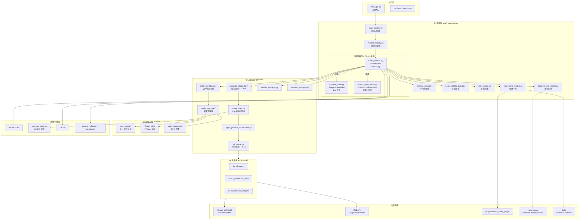
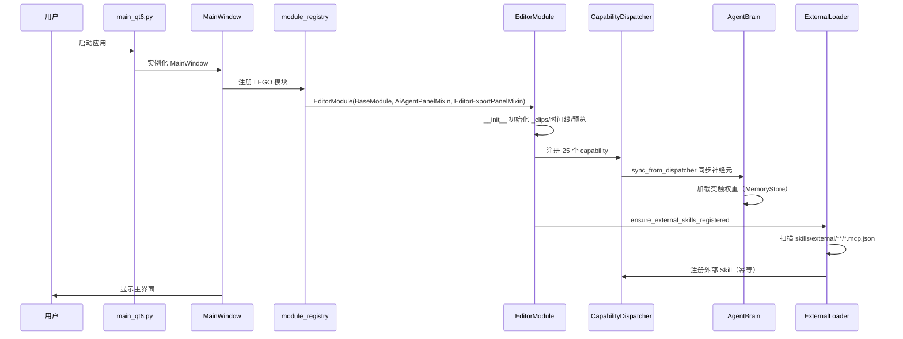
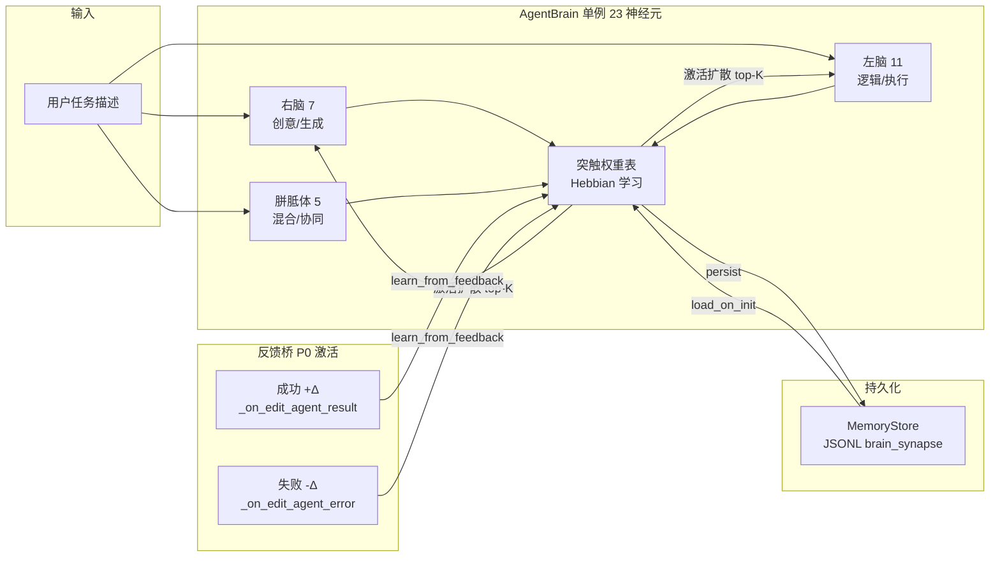
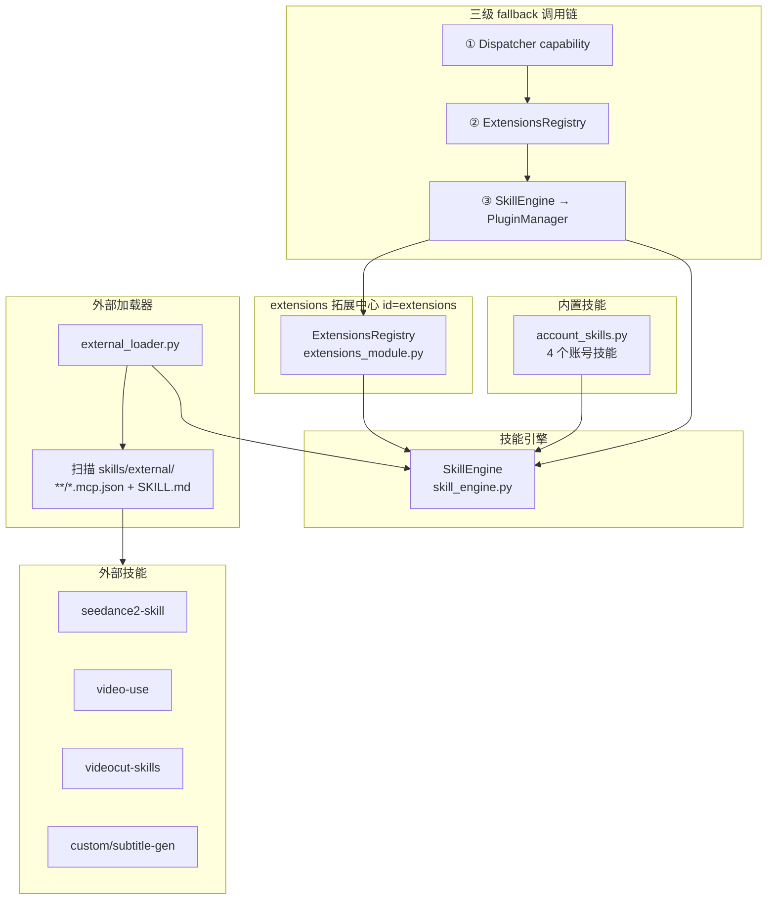
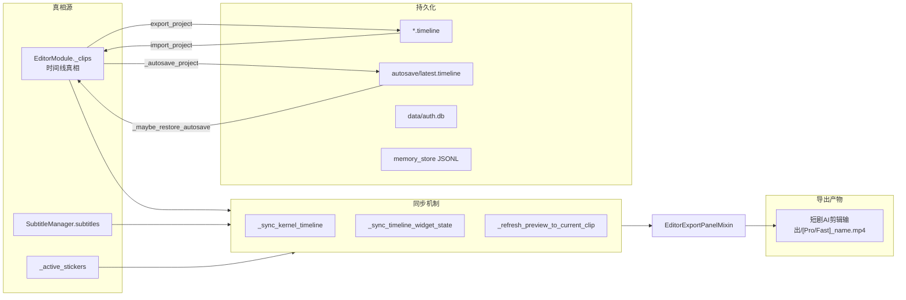
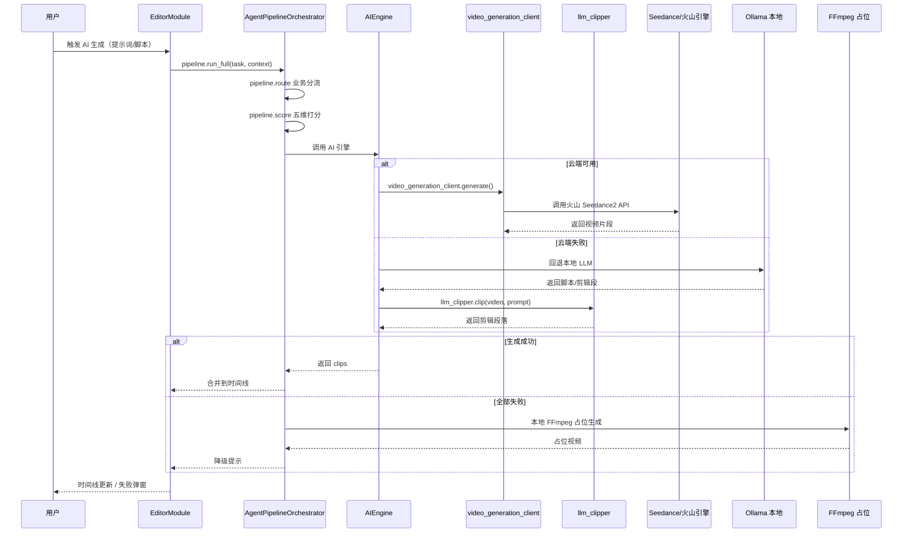
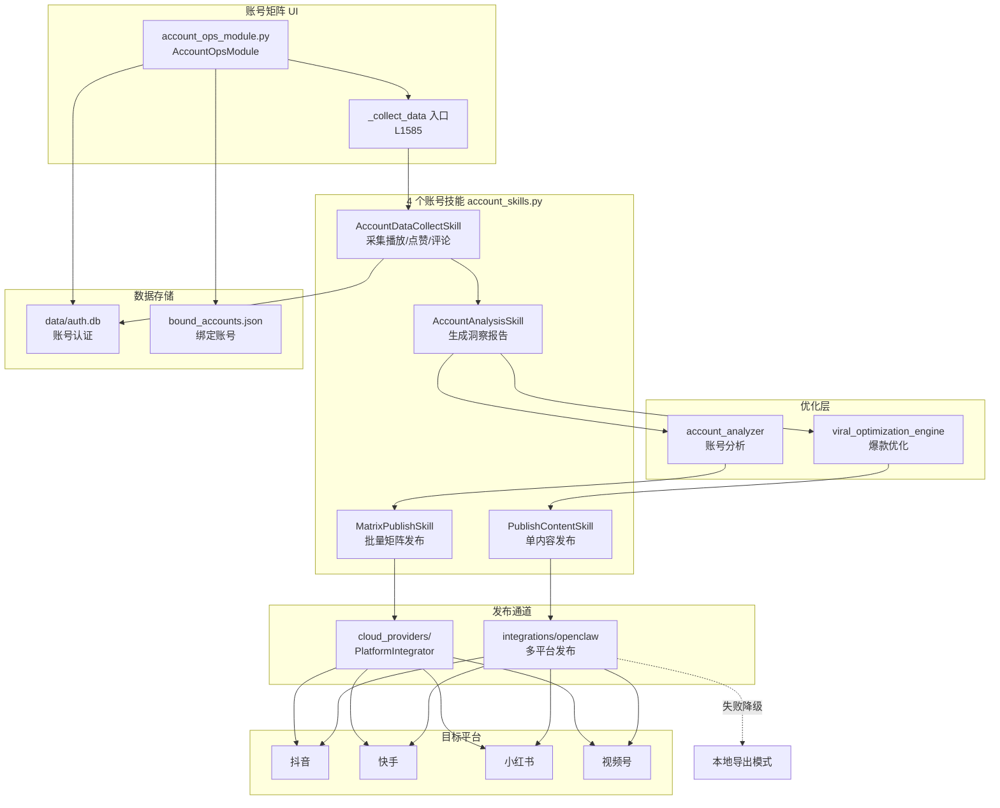
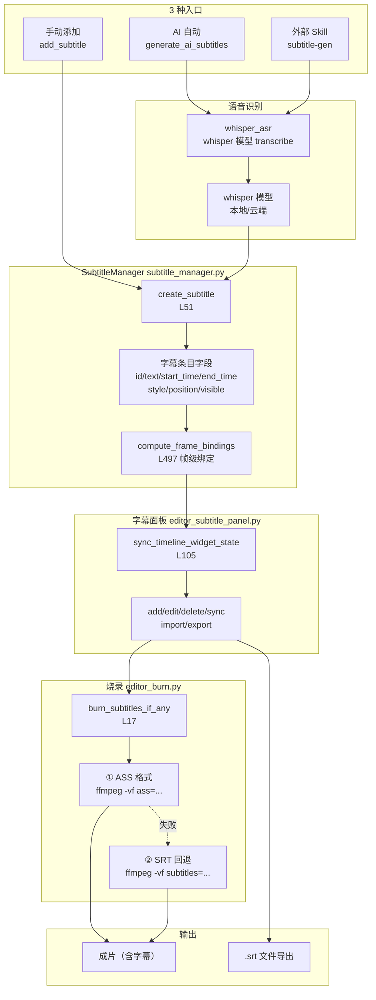

# 02 — 架构

> 复核：2026-08-05（P0 拆分后追加架构运行图）

## 分层

```
Application (main_qt6.Application)
  └── MainWindow + ModuleRegistry（懒加载 LEGO 模块）
        └── EditorModule / Home / Settings / Extensions / …
              ↕ EventBus
        └── app/core（Timeline / Preview / FFmpeg / Scheduler / AI / Plugins / Agent）
```

## 启动序列

1. UTF-8 / crash hook  
2. 环境检查（PyQt6 必需，FFmpeg/GPU 建议）  
3. 路径 / EventBus / MasterClock / DataBus / SkillEngine / Auth  
4. 基础设施（security / permission / APM / alert / i18n）best-effort  
5. Blocks + Skills（含 `video_editing_skill.register_skills` 等）  
6. Qt Fusion + 深色 QSS  
7. MainWindow → 默认 home  
8. `qt_app.exec()`

## 双内核（`editor_scheduler.py`）

| 操作 | 倾向内核 |
|------|----------|
| preview / probe | LIGHTWEIGHT（PyAV） |
| clip / export / multi_track / ai_clip | PROFESSIONAL（FFmpeg/MLT） |

## 剪辑副路径（抽出模块）

```
EditorModule（宿主 ~10.8k）
  ├── clip_transform / editor_export / editor_burn     # 变换·导出·烧录
  ├── editor_subtitle_panel                            # 字幕 UI + AI + 去水词
  │     └── text_frame_map → edit_commands / filler_silence_detect
  └── Agent 面板 → capability_dispatcher → agent_pipeline_orchestrator
```

多轨导出改动优先读 `editor_export.py`，勿再堆进宿主上帝类。

## 渲染栈注意

存在多份 `RenderManager` / FFmpeg 查找逻辑：

- **活导出**: `app/core/render_manager.py`（经 scheduler）+ `editor_export` 拼片/叠轨
- `ExportRenderer`（`modules/render` 与 `lego/render`）：**2026-08 复核仍无业务引用**，勿当真相源
- `AppState`：**仍无外部引用**，勿当真相源（真相源 = `EditorModule._clips`）

## 插件 / 拓展三层

1. `core/plugin_manager` + `plugin_loader`  
2. `app/plugins/`（effect_/transition_/ai_effects/drama_finder）  
3. LEGO：**拓展中心** `extensions_module`（registry id=`extensions`）+ Blocks + SkillEngine + MCP  

旧 `plugins_module` 含短剧常驻标签实现，但**未注册**；运行时短剧以拓展中心弹窗 / 插件 `run()` 为主。冻结区 `drama-finder-ui` 仍锁 `plugins_module` 符号 + `drama_ui.py`。

## 关键约束

- 模块间优先 EventBus，避免硬依赖  
- UI 渲染，core 处理数据，MainWindow 调度  
- 对话框必须有 parent  
- **最小入侵、最大兼容**；不擅自重写时间线架构  
- 改播放/停声/画布变换/商店目录前先解冻（见 `08-frozen-zones.md`）

---

## 架构运行图（2026-08-05 复核）

> 以下为 P0 拆分（AgentBrain 学习激活 + 关键路径测试 + editor_module Mixin 拆分）后的整体架构运行图。

### 一、分层架构总览



### 二、EditorModule Mixin 拆分（P0 成果）

```
EditorModule(BaseModule, AiAgentPanelMixin, EditorExportPanelMixin)
    │
    ├─ MRO 解析顺序：
    │   EditorModule → BaseModule → AiAgentPanelMixin → EditorExportPanelMixin → object
    │
    ├─ AiAgentPanelMixin（6 AI 方法）
    │   _on_ai_clip / _on_ai_clip_fallback / _on_ai_fail / _on_ai_progress
    │   _apply_agent_commands_to_editor / _apply_agent_command
    │
    └─ EditorExportPanelMixin（8 导出方法）
        _has_timeline_edits / _is_export_audio_clip
        _collect_export_audio_clips / _collect_export_overlay_clips
        _prebake_overlay_clips_for_export / _finalize_multitrack_export
        _build_edited_video / _export_video
```

| 维度 | 拆分前 | 拆分后 |
|------|--------|--------|
| EditorModule 行数 | ≈10760 | **10424**（-336） |
| AI 方法位置 | 内嵌 | AiAgentPanelMixin |
| 导出方法位置 | 内嵌 | EditorExportPanelMixin |
| 循环导入风险 | 无 | 已规避（show_clear_messagebox 延迟导入） |

保留未迁移：`_burn_subtitles_if_any` / `_burn_stickers_if_any` / `export_project` / `import_project` / `_on_export_script_clicked`。

### 三、启动链路



### 四、双内核与三级 fallback

```
editor_scheduler.export_video()
        │
        ├── kernel_mode = "fast" ─→ PyAV 轻量内核（预览/草稿）
        │
        └── kernel_mode = "pro"  ─→ FFmpeg/MLT 专业内核（成片）
                                        │
                                        ▼
                              RenderManager.render()
                                        │
                          ┌─────────────┼─────────────┐
                          ▼             ▼             ▼
                    ① C++ 引擎    ② FFmpeg CLI   ③ CPU 回退
                    NVENC/QSV/    subprocess     moviepy/纯计算
                    AMF 硬件加速                  兼容性最好
                          └─────失败自动降级──────────┘
```

### 五、Agent 左右脑神经网络



### 六、23 capability 分发

```
CapabilityDispatcher.invoke(CapabilityRequest)
        │
        ├─ 右脑（创意类 7 个）
        │   model.chat / model.chat_with_fallback
        │   pipeline.generate / pipeline.generate_script
        │   ext.run_extension / ext.run_skill / account.optimize_strategy
        │
        ├─ 左脑（逻辑类 11 个）
        │   editor.split_clip / editor.apply_filter / editor.add_transition
        │   editor.get_timeline_context / workflow.start / workflow.submit_batch
        │   account.collect_data / account.publish
        │   pipeline.preview_validate / pipeline.regenerate_clip / pipeline.execute_editing
        │
        └─ 胼胝体（混合类 5 个）
            pipeline.route / pipeline.score / pipeline.run_full
            model.list_models / ext.list_tools
```

### 七、外部技能与拓展生态



### 八、数据流与状态管理



### 九、关键路径文件清单

| 层级 | 文件 | 职责 |
|------|------|------|
| 入口 | `app/main_qt6.py` | 应用启动 |
| 主窗口 | `app/modules/lego/main_window.py` | 窗口调度 |
| 注册表 | `app/modules/lego/module_registry.py` | 模块注册 |
| 编辑器 | `app/modules/lego/editor_module.py` | 编辑器主体 |
| AI Mixin | `app/modules/lego/ai_agent_panel.py` | AI 方法 |
| 导出 Mixin | `app/modules/lego/editor_export_panel.py` | 导出方法 |
| 导出实现 | `app/modules/lego/editor_export.py` | 多轨收尾 |
| 字幕烧录 | `app/modules/lego/editor_burn.py` | 字幕/贴纸烧录 |
| 时间线 | `app/modules/lego/timeline_widget.py` | 时间线画布 |
| 预览 | `app/core/preview_manager.py` | 预览管理 |
| 调度器 | `app/core/editor_scheduler.py` | 双内核 |
| 时间线数据 | `app/core/timeline_manager.py` | 时间线数据 |
| Agent 大脑 | `app/core/agent_brain.py` | 神经网络 |
| 能力分发 | `app/core/capability_dispatcher/` | 23 capability |
| 渲染管理 | `app/core/render_manager/` | 三级 fallback |
| 记忆存储 | `app/core/memory_store.py` | JSONL 持久化 |

### 十、冻结区与规则约束

- 冻结区：53 locks（`frozen_zones.json`），未获「解冻 \<zone-id\>」前禁改 `FROZEN:*` 标记块
- 检查：`python scripts/frozen_zone_guard.py`
- 解冻改完后重写基线：`python scripts/frozen_zone_guard.py --update`
- 架构边界铁律：UI 渲染、core 处理数据、MainWindow 调度；弹窗必须 parent；状态归集 auth/core；渲染走 RenderManager；最小侵入、最大兼容

### 十一、AI 视频生成链路（pipeline.generate） ⚠️ 待修正：基于命名推测，route→score 顺序错误



**关键决策点：**
- `pipeline.route`：判断任务走「生成」/「剪辑」/「分析」分支
- `pipeline.score`：五维打分（画面/节奏/情绪/创意/技术），低于阈值触发重生成
- AI 引擎路由策略：云端 API 优先 → Ollama 本地回退 → FFmpeg 占位
- `llm_clipper`：输入视频+提示词，输出剪辑段落（时间区间+理由）

### 十二、账号矩阵发布流程（account.\*） ⚠️ 待修正：MatrixPublishSkill 与 PublishContentSkill 画成并行，实际独立



**端到端流程：**
1. **采集**（`account.collect_data`）：从各平台采集播放/点赞/评论等指标
2. **分析**（`AccountAnalysisSkill`）：基于历史数据生成洞察报告
3. **优化**（`account.optimize_strategy`）：基于 `viral_optimization_engine` + `account_analyzer` 输出趋势分析、Top 表现、优化建议
4. **发布**（`account.publish`）：走 `openclaw` + `PlatformIntegrator`，失败降级为本地导出

**Fallback 机制：**
- 平台连接失败 → 降级本地导出模式
- 单内容发布失败 → 矩阵发布跳过该账号继续其他
- 账号认证过期 → 从 `auth.db` 重新加载 token

### 十三、字幕生成管线（subtitle-gen） ⚠️ 待修正：FIELDS 数据结构不应是流程节点，烧录入口画错



**字幕条目数据结构：**
- `id` — 唯一标识
- `text` — 字幕文本
- `start_time` / `end_time` — 起止时间（秒）
- `style` — 样式（字体/颜色/大小）
- `position` — 位置
- `visible` — 是否可见

**烧录 fallback：**
- 优先 ASS 格式（支持复杂样式、动画）
- 失败回退 SRT 格式（兼容性最好）
- 全部失败 → 字幕保留在时间线，但不烧录到视频

**AI 字幕流程：**
1. 用户点击「AI 字幕」→ `generate_ai_subtitles`
2. 调用 `whisper_asr.transcribe(video_path)` 进行语音识别
3. 识别结果按时间分段 → 调用 `editor._subtitle_manager.create_subtitle` 批量创建
4. `compute_frame_bindings` 将字幕与时间线帧级绑定
5. `sync_timeline_widget_state` 同步到 UI 面板

**关键文件：**
- [editor_subtitle_panel.py](file:///d:/拾光剪影/app/modules/lego/editor_subtitle_panel.py) — 字幕 UI（`generate_ai_subtitles` L781）
- [subtitle_manager.py](file:///d:/拾光剪影/app/core/subtitle_manager.py) — 字幕数据（`create_subtitle` L51, `compute_frame_bindings` L497）
- [editor_burn.py](file:///d:/拾光剪影/app/modules/lego/editor_burn.py) — 字幕烧录（`burn_subtitles_if_any` L17）
- [skills/custom/subtitle-gen](file:///d:/拾光剪影/app/skills/custom/subtitle-gen) — 外部字幕生成技能

---

### 十四、Agent 框架架构评价（CTO 视角 · 2026-08-06）

> ⚠️ 本章节基于完整通读 7 个核心文件的**真实代码证据**，非命名推测。
> 覆盖文件：agent_pipeline_orchestrator.py(570行)、agent_pipeline_router.py(220行)、capability_handlers.py(515行)、agent_feedback_bridge.py(280行)、agent_brain.py(~400行)、account_skills.py(618行)、editor_subtitle_panel.py(964行)。

#### 架构亮点 ✅

##### 1. Hebbian 学习 — 真实激活，闭环完整

4 条真实学习路径（非死代码）：
| 路径 | 触发点 | 调用 |
|------|--------|------|
| Pipeline 完成 | `agent_pipeline_orchestrator._emit_done()` | `agent_brain.reinforce_path(path, success)` |
| 发布结果回流 | `agent_feedback_bridge.submit_feedback()` | `agent_brain.learn_from_feedback(brain_feedback)` |
| 质检问题回流 | `agent_feedback_bridge.submit_quality_issue()` | `agent_brain.learn_from_feedback(brain_feedback)` |
| Agent 结果/错误 | `editor_module._on_edit_agent_result/error` | `agent_brain.learn_from_feedback(feedback)` |

AgentFeedbackBridge 做了 severity 映射（播放量 <5000 → high）和 issue_type → capability 的精准关联。

##### 2. 23 Capability 注册 — 完整且精准

capability_handlers.py 的 `register_builtin_handlers` 与 agent_brain._NEURON_TAXONOMY 一一对应，注册后调用 `agent_brain.sync_from_dispatcher` 让 AgentBrain 感知所有能力。

##### 3. Pipeline 六级流程 — 真实顺序（纠正之前错误的图）

```
route → [generation | editing] → preview_validation → scoring → script_generation → execute_editing
                                                              └→ _emit_done + reinforce_path (Hebbian)
```

preview_validation 可等待人工确认（`auto_preview_pass=False` 暂停流程），各阶段 except Exception + logger.debug 保证流程不中断。

##### 4. Fallback 链 — 多层且真实可用

| 场景 | Fallback 链 | 证据 |
|------|------------|------|
| ASR | whisper(base) → whisper(tiny) → SubtitleGenerator → emit_fail | editor_subtitle_panel.py L864-919 |
| 数据采集 | DataCollector 真实 → account_analyzer 本地缓存 → 标记无数据 | account_skills.py L73-99 |
| 发布 | PlatformIntegrator 真实 → 本地导出 | account_skills.py L416-456 |
| 业务分流 | GENERATION 回溯重写提示词(MAX_RETRIES=2) → 模板占位 | ai_video_generation_pipeline.py L87 |

#### 架构问题与风险 ⚠️

##### P0（高风险，建议 1-2 周内修复）

**P0-1: EditorCapabilityHandlers 调用 EditorModule 私有方法（紧耦合）** — **已收口（M4 / 2026-08-07）**

Handlers 与对话路径改走 `agent_split_clip` / `agent_apply_filter` / `agent_apply_transition` / `agent_get_timeline_context` / `agent_ripple_delete_range`。仍直接读 `editor._clips` / `_current_clip`（数据面，非方法硬绑）。

**P0-2: Pipeline reinforce_path 基于预设路径（非真实执行路径）**

agent_pipeline_orchestrator.py L548-563 的 reinforce_path 是**预设路径**（成功时走的路），不是**实际执行路径**。如果 pipeline 在 preview_validation 阶段就挂了，reinforce_path 仍然会把 generate→preview→score→script→execute 全部强化（或弱化），这不准确。

##### P1（中风险，建议 2-4 周内修复）

**P1-1: AgentPipelineRouter 分流逻辑过于简单**

agent_pipeline_router.py L116-124 只看「有没有素材」，完全忽略创意简报、目标平台、时长等上下文。混合处理场景（基于素材再创作）会被误判。

**P1-2: AccountAnalysisSkill 没有调用 ViralOptimizationEngine**

AccountAnalysisSkill 是纯本地分析，但 AccountCapabilityHandlers.optimize_strategy 确实调用了 ViralOptimizationEngine。两条路径能力不对等。

**P1-3: account.publish 默认 skill_id 不存在**

capability_handlers.py L282 的默认值 `"account_publish"` 在 account_skills.py 中不存在（实际是 `"matrix_publish"` 和 `"publish_content"`），默认找不到 skill。

**P1-4: Agent editor capability 覆盖仍薄（差距大）**

已暴露 6 个：`split` / `filter` / `transition` / `timeline_context` / `ripple_delete_range` / **`suggest_cleanup`（M5）**。导入、导出、字幕 CRUD、贴纸、关键帧、调色等仍未暴露（按 70/20/10 策略按需加，不堆卖点）。

##### P2（低风险，技术债）

- 导入风格不统一（41 处）
- Skill 框架部分绕开 SkillEngine 直接做业务
- severity 阈值硬编码（5000/20000 播放量）

#### Agent 能力覆盖现状（基于代码证据）

| 能力 | 状态 | 说明 |
|------|------|------|
| 扩展层插件 | ✅ | ExtensionsRegistry → SkillEngine 两级 fallback |
| Skill | ✅ | 4 个账号 Skill + custom + external loader 扫描 |
| MCP | ❌ | 没有 `mcp.*` capability，SkillEngine 有 MCP 代码但未暴露 |
| 剪辑功能（全部） | ⚠ | 6 个 editor.*（含建议确认去水词 / 波纹删）；大量方法仍未暴露 |

#### 量化指标

| 指标 | 当前值 |
|------|--------|
| capability 注册数 | 25（含 suggest_cleanup / ripple_delete_range） |
| 学习路径数 | 4（全部有真实业务入口） |
| fallback 链完整度 | 5/7 场景有真实 fallback |
| 紧耦合点（handler → 私有方法） | 0（方法面；数据面仍读 `_clips`） |
| MCP capability | 0（需新增） |

#### P0-A / M4 修复进度

- ✅ 冻结区检查通过（53 locks intact）
- ✅ EditorModule 公开包装：`agent_split_clip` / `agent_apply_filter` / `agent_apply_transition` / `agent_get_timeline_context` / `agent_ripple_delete_range` / `agent_execute_pipeline_editing`
- ✅ capability_handlers + 对话白名单对齐；测例 `test_editor_ripple_capability.py`
- ✅ M5：`editor.suggest_cleanup` + 勾选对话框；去水词不默认全删 / 不成片
